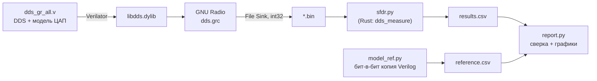

# Моделирование статической нелинейности ЦАП AD9081 в DDS-тракте

**Промежуточный отчёт** · ветка `gnu-dds-nonlin_dac` · 11.10.2026
Этап 1 из 2: нелинейность ЦАП (INL/DNL), тесты SFDR и IMD3. Этап 2 (джиттер такта) — следующий.

---

## 1. Задача

По плану работы:

1. Смоделировать нелинейность ЦАП: внести управляемую погрешность передаточной характеристики на уровне AD9081 (Table 3: INL 8 LSB, DNL 3.5 LSB, 16 бит). Посмотреть, какие гармонические искажения (HD2, HD3) она даёт.
2. Повторить тесты из даташита - однотоновый (SFDR) и двухтоновый (IMD3) - и сравнить с Table 16 (DAC AC Specifications, fDAC = 12 GSPS).

**Главный вывод.** Статическая нелинейность уровня Table 3 даёт SFDR 74–86 dBc, медиана около 80 dBc. Это совпадает с даташитом только на низких частотах (≤ 1.9 ГГц). Падение SFDR на высоких частотах и IMD3 −69…−72 dBc статикой не объясняются: это динамические эффекты ЦАП.

---

## 2. Тестовый стенд



| файл | роль |
|---|---|
| `dds_gr_all.v` | DDS на 1 или 2 тона + модель ЦАП (`dac_nonlin`) |
| `build.sh` | для каждого сценария и частоты: сборка в Verilator → GNU Radio → измерение → эталон |
| `sfdr.py` | когерентное измерение SFDR / HD2 / HD3 / IMD3 |
| `model_ref.py` | независимая побитовая модель на Python: эталон для проверки цепочки, расчёт INL/DNL |
| `report.py`, `make_figures.py` | таблицы и графики |
| `measure_rs/` | тот же измеритель на Rust (перекрёстная проверка) |

**Проверка цепочки.** Каждая точка считается дважды: через Verilog → Verilator → GNU Radio и через `model_ref.py`. На всех 66 точках расхождение **0.000 дБ**. Значит, сборка, обёртка, GNU Radio и запись в файл ничего не искажают, и все цифры ниже описывают только модель ЦАП. Rust-измеритель даёт те же числа, что Python.

---

## 3. Модель: пояснение кода

### 3.1 Источник сигнала: DDS (`dds_core`, `quantize`)

```verilog
phase <= phase + ftw;                    // 48-битный аккумулятор фазы
addr   = ph16[15 -: AW];                 // AW старших бит -> адрес ROM синуса
tone  <= (rom[addr] * am) >> 16;         // амплитуда, точность RW = 20 бит
```

- **Частота когерентная:** `FTW = M << (48 − 15)`, то есть тон ровно на бине M быстрого преобразования Фурье длиной 32768 (M нечётное). При fDAC = 12 GSPS это fOUT = M/32768·12 ГГц.
- **Амплитуда:** `AM_1T = 29274` → −7.0 dBFS (как в Table 16 для SFDR); `AM_2T = 32768` → −6.0 dBFS на тон (как для IMD3).
- **Два тона** (`TONES=2`): второй `dds_core` с M2 = M1 + 2. Тона складываются на 20-битной точности и **округляются до 16 бит один раз** (`quantize`). Так квантование не добавляет лишних искажений.
- **AW = 16 ≥ log2(N) = 15** - в когерентном режиме нет усечения фазы. Почему это критично, показывает сценарий `aw14` (раздел 5).

### 3.2 Модель ЦАП (`dac_nonlin`)

Выход ЦАП = идеальный код + три ошибки, все в единицах 1/16 LSB:

```verilog
X2 = (X*X)  >>> 15;                              // x², нормирован к полной шкале
X3 = (X2*X) >>> 15;                              // x³
E2 = (C2  * (ONE - X2) + HALF) >>> 15;           // «дуга»:     C2·(1 − x²)
E3 = (C3K * (X3 - X)   + HALF) >>> 15;           // «S-кривая»: C3·2.598·(x³ − x)
ES = eseg[seg];                                  // рассогласование сегментов
Y  = (X <<< FRAC) + E2 + E3 + ES;
```

**Полиномиальная составляющая INL** (рис. 1, верхний ряд):
- **«Дуга»** `C2·(1 − x²)` - чётная функция, даёт **HD2**. На краях шкалы 0, в центре C2.
- **«S-кривая»** `C3·2.598·(x³ − x)` - нечётная, даёт **HD3**. Множитель 2.598 = 3√3/2 нормирует пик к C3: максимум |x³ - x| равен 0.385 при x = 1/√3.
- Линейная часть (-x) вычтена. Поэтому модель не добавляет ошибку усиления и не уходит в насыщение у края шкалы. В старой модели (`8·x³`) реальный INL был около 3 LSB, а коды у полной шкалы зажимались.

**Рассогласование сегментов, DNL** (рис. 1, нижний ряд; рис. 2). У AD9081 токовый ЦАП с сегментацией (стр. 43 даташита): старшие биты включают одинаковые источники тока, «унарные сегменты». В модели 64 сегмента (`SEG_BITS = 6`), у каждого случайная ошибка веса d_k:

```verilog
// при старте: 64 случайных числа (ГПСЧ, SEED) -> убрать среднее -> масштаб max|d_k| = DNL_Q
eseg[s+1] = eseg[s] + dk[s];     // ошибка = сумма ошибок всех включённых сегментов
seg = {~din[15], din[14:0]} >> 10;   // код со смещением -> число включённых сегментов
```

- На границе сегментов выход прыгает на d_k - это **DNL**.
- Накопленная сумма - случайное блуждание, которое само создаёт **INL** в несколько LSB. Так устроен INL настоящего сегментированного ЦАП.

**Дробные биты (`FRAC = 4`).** Выход 20-битный, полная шкала 2^19. Дробные ошибки (0.3 LSB и т. п.) сохраняются, а не перекругляются до целого LSB. Иначе повторное квантование добавило бы свой шум.

**Сценарии** (`build.sh`):

| сценарий | что включено | INL, LSB | DNL, LSB |
|---|---|---|---|
| `ideal` | идеальный ЦАП, только квантование 16 бит | 0 | 0 |
| `aw14` | идеальный ЦАП, но ROM на 14 бит адреса | 0 | 0 |
| `inl2` | дуга 8 LSB | 0…+8.0 | ±0.06 |
| `inl3` | S-кривая 8 LSB | −8.0…+8.0 | ±0.06 |
| `dnl` | только сегменты, DNL 3.5 | −10.4…+1.9 | −3.50…+3.06 |
| `full` | дуга 3 + S 3 + сегменты 3.5, SEED = 8 | **−7.9…+5.2** | **−3.50…+3.06** |

`full` подобран под Table 3: INL ±8 LSB, DNL 3.5 LSB.


*Рис. 1. INL по сценариям. Серая полоса - диапазон кодов, который проходит тон −7 dBFS: только эта часть характеристики влияет на SFDR.*


*Рис. 2. DNL сценария `full`: скачки на 64 границах сегментов.*

---

## 4. Методика измерений (`sfdr.py`)

1. Из файла берутся 32768 отсчётов после пропуска 1000 (переходный процесс).
2. Окно **прямоугольное**: тон лежит точно на бине (когерентная выборка), утечки нет. Скрипт это проверяет и предупреждает при утечке.
3. Метрики:
   - **SFDR** - несущая минус худший спур во всей полосе 0…fDAC/2, без DC;
   - **HD2/HD3** - уровень на бинах 2M и 3M с учётом заворота по Найквисту, в dBc;
   - **IMD3** - продукты на 2f1−f2 и 2f2−f1 относительно более сильного тона (как в даташите).
1. Точки по частоте - как в Table 16. M - ближайшее нечётное к fOUT·32768/12000:

| fOUT, МГц | 70 | 100 | 500 | 900 | 1900 | 2600 | 3700 | 4500 |
|---|---|---|---|---|---|---|---|---|
| M | 191 | 273 | 1365 | 2457 | 5189 | 7099 | 10103 | 12289 |

Двухтон: M2 = M1 + 2, разнос 0.73 МГц (в даташите 1 МГц). Для статической модели разнос не важен.

---

## 5. Результаты

### 5.1 Однотон, 900 МГц, −7 dBFS


*Рис. 3. Спектры по сценариям. Треугольник — худший спур, по нему считается SFDR.*

| сценарий | SFDR, dBc | худший спур        | HD2, dBc  | HD3, dBc  | теория                                                    |
| -------- | --------- | ------------------ | --------- | --------- | --------------------------------------------------------- |
| ideal    | 119.1     | шум квантования    | < -150    | -137.6    | средний шум ≈ -133 dBc/бин, пик среди 16 384 бинов ≈ -120 |
| aw14     | **80.4**  | спур усечения фазы | < -150    | -129.4    | 6.02·AW - 3.92 = **80.36**                                |
| inl2     | 85.3      | HD2                | **-85.3** | -137.6    | C2·a/(2·FS) → **-85.27**                                  |
| inl3     | 90.0      | HD3                | < -150    | **-90.0** | C3·2.598·a²/(4·FS) → **-90.00**                           |
| dnl      | 74.3      | HD4                | -77.2     | -99.0     | -                                                         |
| full     | 74.3      | HD4                | -78.6     | -125.5    | -                                                         |

(a = 0.447 - амплитуда -7 dBFS, FS = 32768.)

**Что это значит.**

- **ideal.** Пол модели - 119 dBc. Примерно на 40 дБ выше SFDR из даташита, поэтому любая деградация вызвана моделируемым эффектом, а не стендом.
- **aw14.** Усечение фазы до 14 бит даёт 80.4 dBc точно по теории. Это тот же порядок, что 77-80 dBc в Table 16. Поэтому ранние прогоны с AW = 14 фактически измеряли DDS, а не ЦАП. Это главная причина переделки стенда.
- **inl2 / inl3.** HD2 и HD3 совпадают с аналитикой до 0.05 дБ: модель реализует ровно заданный полином. Чётная дуга не даёт HD3, нечётная S-кривая - HD2.
- **dnl / full.** Ступенчатый INL сегментов не гладкий, поэтому даёт гармоники всех порядков (на рис. 3 видна «гребёнка» гармоник высоких порядков, свёрнутых по Найквисту), а не только 2 и 3. Это **самый сильный механизм**: при DNL 3.5 LSB SFDR = 74.3 dBc. В `full` HD3 почти исчез (-125.5) - нечётная часть блуждания сегментов случайно погасила S-кривую. Это свойство конкретного SEED, см. 5.3.

### 5.2 Двухтон, 1900 МГц, −6 dBFS на тон


*Рис. 4. Окрестность тонов. Продукты IMD3 на 2f1−f2 и 2f2−f1.*

| сценарий | IMD3, dBc               | теория                                     |
| -------- | ----------------------- | ------------------------------------------ |
| inl2     | -126.9 (на уровне шума) | чётная нелинейность не создаёт 2f1-f2      |
| inl3     | **-78.5**               | 3·C3·2.598·b²/(4·FS), b = 0.5 → **-78.49** |
| dnl      | -93.3                   | -                                          |
| full     | -92.3                   | -                                          |

IMD3 от S-кривой на 11.5 дБ хуже, чем её HD3. Так и должно быть: для x³ продукт IMD3 по амплитуде в 3 раза больше HD3 (+9.5 дБ), а тоны громче (−6 против -7 dBFS, +2 дБ к отношению).

### 5.3 Разброс по реализации рассогласования

Сегментная ошибка случайная, поэтому один SEED - это одна микросхема из партии. Прогон по 20 значениям SEED:


*Рис. 7. Каждая точка - одна реализация рассогласования, линия - медиана. Серая полоса - SFDR из Table 16 на частотах ≤ 1.9 ГГц.*

|                          | SFDR, dBc        | HD2, dBc | HD3, dBc | IMD3, dBc | пик INL, LSB   |
| ------------------------ | ---------------- | -------- | -------- | --------- | -------------- |
| dnl, медиана (мин…макс)  | 80.1 (73.0…85.8) | −82.6    | −87.5    | −92.3     | 8.4 (4.3…13.6) |
| full, медиана (мин…макс) | 80.5 (73.0…85.8) | −82.6    | −86.5    | −86.4     | 9.9 (4.9…14.0) |

- SEED = 8 (выбран, чтобы INL ≈ 8 LSB) попал в **худшую четверть** по SFDR: 74.3 против медианы 80.5.
- **Медиана SFDR ≈ 80 dBc ровно попадает в диапазон даташита (76–80 dBc) на низких частотах.**
- Худший спур в разных реализациях - HD2, HD4, HD3 или HD9. Это признак сегментной, а не полиномиальной природы ошибки.

---

## 6. Сравнение с Table 16


*Рис. 5. SFDR от частоты: модель и даташит. Кривые dnl и full совпадают (74.3 dBc).*


*Рис. 6. IMD3 от частоты: модель и даташит.*

**SFDR.**
- Модель **не зависит от частоты** - так и должно быть у статической нелинейности: ошибка зависит от кода, а не от скорости его изменения.
- На **fOUT ≤ 1.9 ГГц** модель с INL/DNL уровня Table 3 даёт 74–86 dBc (медиана 80). Это тот же уровень, что в даташите (76–80 dBc). Статическая нелинейность - правдоподобный источник SFDR на низких частотах.
- Оговорка: INL/DNL в Table 3 указаны при **выключенном** shuffle, а SFDR в Table 16 - при **включённом**. Shuffle перемешивает сегменты и превращает сегментные спуры в шум. Поэтому модель `full` описывает ЦАП без shuffle, и реальный прибор на низких частотах должен быть не хуже модели.
- На **2.6–4.5 ГГц** SFDR в даташите падает до 68–69 dBc, а модель остаётся плоской. Разница 6–12 дБ - **динамические** эффекты: глитчи переключения, конечное время установления, частотно-зависимый выходной импеданс. Статическая модель их не содержит в принципе.

**IMD3.**
- Модель даёт −92 dBc (худшая реализация около −79), даташит - от −69 до −72 dBc.
- Чтобы статической S-кривой получить IMD3 = -70 dBc, нужен C3 ≈ 21 LSB - в 2.7 раза больше INL из даташита.
- Вывод: **IMD3 реального AD9081 определяется динамической нелинейностью**, а не статической.

---

## 7. Выводы

1. Стенд Verilog → Verilator → GNU Radio → Python/Rust проверен: побитовое совпадение с независимой моделью, 0.000 дБ на 66 точках.
2. Модель воспроизводит теорию: HD2, HD3, IMD3 от полиномиального INL и спуры усечения фазы - с точностью до 0.05 дБ.
3. Усечение фазы в DDS (AW = 14 → 80.4 dBc) было бы неотличимо от характеристик ЦАП из даташита. Для когерентных тестов нужно AW ≥ log2(N).
4. Главный статический механизм - рассогласование сегментов (DNL), а не гладкий INL. Гладкий INL на 8 LSB даёт 85–90 dBc, сегментный при том же уровне INL - 73–86 dBc.
5. Статическая нелинейность из Table 3 объясняет SFDR AD9081 на низких частотах (≈ 80 dBc). Частотную зависимость SFDR и уровень IMD3 она не объясняет - это динамика.

## 8. Ограничения и дальнейшие шаги

- Модель статическая: нет памяти, глитчей и зависимости от частоты.
- Не моделируется shuffle - это возможный отдельный сценарий: случайная перестановка сегментов на каждом отсчёте.
- Разнос тонов 0.73 МГц вместо 1 МГц (ограничение сетки быстрого преобразования Фурье на 32768 точек). На статическую модель не влияет.
- **Этап 2:** джиттер такта ЦАП (σ = 10…200 fs) и деградация SNR/NSD в сравнении с NSD из Table 16.

## 9. Как воспроизвести

```bash
cd scripts
./build.sh                       # все сценарии: GNU Radio + сверка -> results/summary.md
QUICK=1 ONLY="inl3 full" ./build.sh
python make_figures.py figures   # графики этого отчёта (из эталонной модели, без GNU Radio)
python model_ref.py --params "NONLIN=1" --inl-dnl --plot inl.png
```
