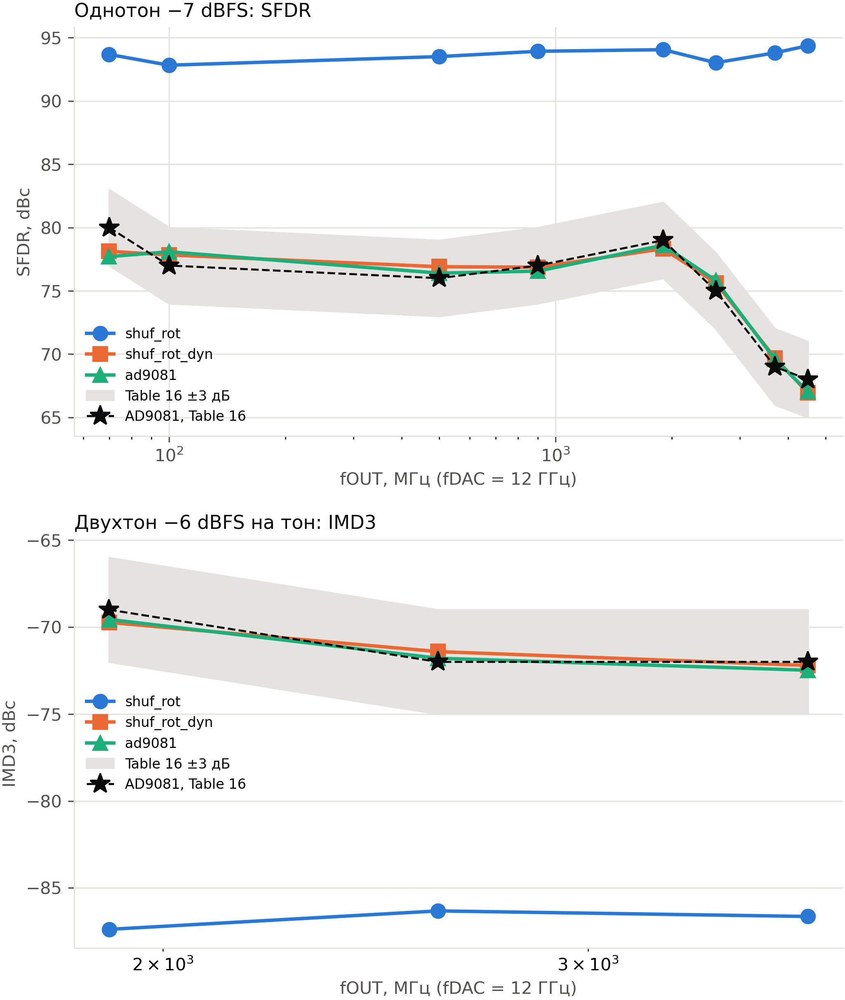
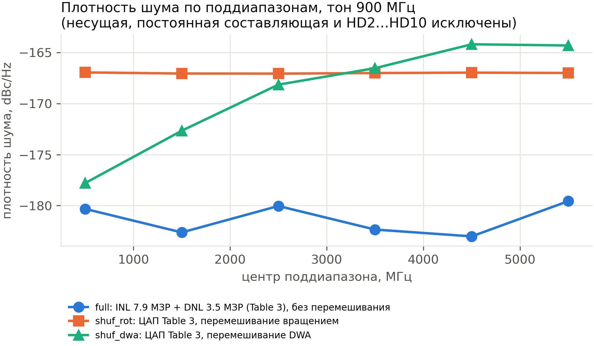
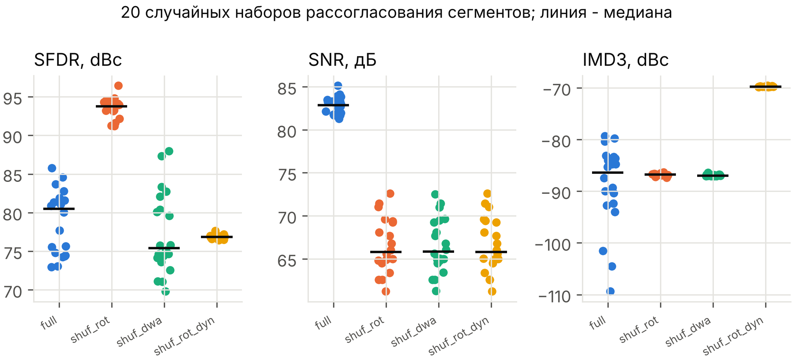
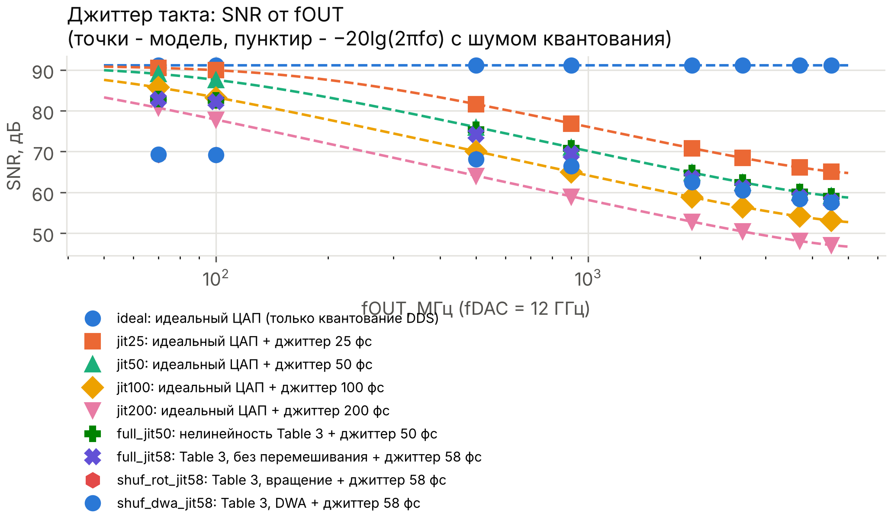
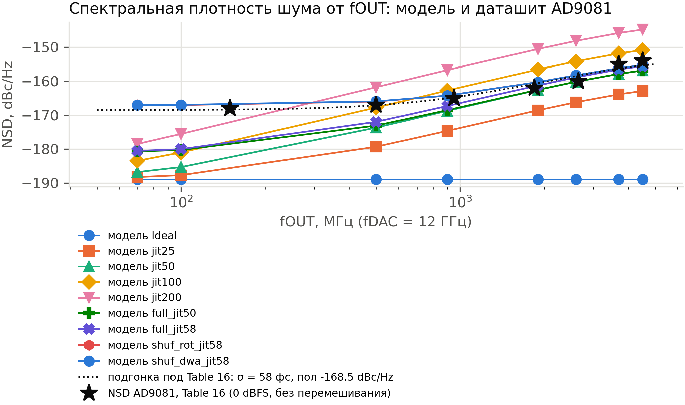

# Нелинейность ЦАП: измерения (цепочка GNU Radio) рядом с Table 16 AD9081

Проверка цепочки: max |измерено − model_ref| = 0.000 дБ на 110 точках (OK)

## Однотон, −7 dBFS

| сценарий | fOUT, МГц | SFDR, dBc | худший спур | HD2, dBc | HD3, dBc | SNR, дБ | NSD, dBc/Hz | SFDR Table 16 |
|---|---|---|---|---|---|---|---|---|
| ideal | 70 | 119.1 | 4196 МГц | < -150 | -137.6 | 91.1 | -188.9 | 80 |
| ideal | 100 | 119.1 | 3616 МГц | < -150 | -137.6 | 91.1 | -188.9 | 77 |
| ideal | 500 | 119.1 | 5922 МГц | < -150 | -137.6 | 91.1 | -188.9 | 76 |
| ideal | 900 | 119.1 | 3460 МГц | < -150 | -137.6 | 91.1 | -188.9 | 77 |
| ideal | 1900 | 119.1 | 772 МГц | < -150 | -137.6 | 91.1 | -188.9 | 79 |
| ideal | 2600 | 119.1 | 5272 МГц | < -150 | -137.6 | 91.1 | -188.9 | 75 |
| ideal | 3700 | 119.1 | 4309 МГц | < -150 | -137.6 | 91.1 | -188.9 | 69 |
| ideal | 4500 | 119.1 | 234 МГц | < -150 | -137.6 | 91.1 | -188.9 | 68 |
| aw14 | 70 | 80.4 | 5930 МГц | < -150 | -129.4 | 80.0 | -177.8 | 80 |
| aw14 | 100 | 80.4 | 5900 МГц | < -150 | -129.4 | 80.0 | -177.8 | 77 |
| aw14 | 500 | 80.4 | 5500 МГц | < -150 | -129.4 | 80.0 | -177.8 | 76 |
| aw14 | 900 | 80.4 | 5100 МГц | < -150 | -129.4 | 80.0 | -177.8 | 77 |
| aw14 | 1900 | 80.4 | 4100 МГц | < -150 | -129.4 | 80.0 | -177.8 | 79 |
| aw14 | 2600 | 80.4 | 3400 МГц | < -150 | -129.4 | 80.0 | -177.8 | 75 |
| aw14 | 3700 | 80.4 | 2300 МГц | < -150 | -129.4 | 80.0 | -177.8 | 69 |
| aw14 | 4500 | 80.4 | 1500 МГц | < -150 | -129.4 | 80.0 | -177.8 | 68 |
| inl2 | 70 | 85.3 | HD2 | -85.3 | -137.6 | 91.1 | -188.9 | 80 |
| inl2 | 100 | 85.3 | HD2 | -85.3 | -137.6 | 91.1 | -188.9 | 77 |
| inl2 | 500 | 85.3 | HD2 | -85.3 | -137.6 | 91.1 | -188.9 | 76 |
| inl2 | 900 | 85.3 | HD2 | -85.3 | -137.6 | 91.1 | -188.9 | 77 |
| inl2 | 1900 | 85.3 | HD2 | -85.3 | -137.6 | 91.1 | -188.9 | 79 |
| inl2 | 2600 | 85.3 | HD2 | -85.3 | -137.6 | 91.1 | -188.9 | 75 |
| inl2 | 3700 | 85.3 | HD2 | -85.3 | -137.6 | 91.1 | -188.9 | 69 |
| inl2 | 4500 | 85.3 | HD2 | -85.3 | -137.6 | 91.1 | -188.9 | 68 |
| inl3 | 70 | 90.0 | HD3 | < -150 | -90.0 | 91.1 | -188.9 | 80 |
| inl3 | 100 | 90.0 | HD3 | < -150 | -90.0 | 91.1 | -188.9 | 77 |
| inl3 | 500 | 90.0 | HD3 | < -150 | -90.0 | 91.1 | -188.9 | 76 |
| inl3 | 900 | 90.0 | HD3 | < -150 | -90.0 | 91.1 | -188.9 | 77 |
| inl3 | 1900 | 90.0 | HD3 | < -150 | -90.0 | 91.1 | -188.9 | 79 |
| inl3 | 2600 | 90.0 | HD3 | < -150 | -90.0 | 91.1 | -188.9 | 75 |
| inl3 | 3700 | 90.0 | HD3 | < -150 | -90.0 | 91.1 | -188.9 | 69 |
| inl3 | 4500 | 90.0 | HD3 | < -150 | -90.0 | 91.1 | -188.9 | 68 |
| dnl | 70 | 74.3 | HD4 | -77.2 | -99.0 | 83.3 | -181.1 | 80 |
| dnl | 100 | 74.3 | HD4 | -77.2 | -99.0 | 83.3 | -181.1 | 77 |
| dnl | 500 | 74.3 | HD4 | -77.2 | -99.0 | 83.3 | -181.1 | 76 |
| dnl | 900 | 74.3 | HD4 | -77.2 | -99.0 | 83.3 | -181.1 | 77 |
| dnl | 1900 | 74.3 | HD4 | -77.2 | -99.0 | 83.3 | -181.1 | 79 |
| dnl | 2600 | 74.3 | HD4 | -77.2 | -99.0 | 83.3 | -181.1 | 75 |
| dnl | 3700 | 74.3 | HD4 | -77.2 | -99.0 | 83.3 | -181.1 | 69 |
| dnl | 4500 | 74.3 | HD4 | -77.2 | -99.0 | 83.3 | -181.1 | 68 |
| full | 70 | 74.3 | HD4 | -78.6 | -125.5 | 83.3 | -181.1 | 80 |
| full | 100 | 74.3 | HD4 | -78.6 | -125.5 | 83.3 | -181.1 | 77 |
| full | 500 | 74.3 | HD4 | -78.6 | -125.5 | 83.3 | -181.1 | 76 |
| full | 900 | 74.3 | HD4 | -78.6 | -125.5 | 83.3 | -181.1 | 77 |
| full | 1900 | 74.3 | HD4 | -78.6 | -125.5 | 83.3 | -181.1 | 79 |
| full | 2600 | 74.3 | HD4 | -78.6 | -125.5 | 83.3 | -181.1 | 75 |
| full | 3700 | 74.3 | HD4 | -78.6 | -125.5 | 83.3 | -181.1 | 69 |
| full | 4500 | 74.3 | HD4 | -78.6 | -125.5 | 83.3 | -181.1 | 68 |
| shuf_rot | 70 | 93.7 | HD2 | -93.7 | -97.3 | 69.2 | -167.0 | 80 |
| shuf_rot | 100 | 92.8 | HD2 | -92.8 | -95.6 | 69.3 | -167.0 | 77 |
| shuf_rot | 500 | 93.5 | HD2 | -93.5 | -97.6 | 69.3 | -167.1 | 76 |
| shuf_rot | 900 | 93.9 | HD2 | -93.9 | -97.2 | 69.2 | -167.0 | 77 |
| shuf_rot | 1900 | 94.1 | HD2 | -94.1 | -96.8 | 69.3 | -167.0 | 79 |
| shuf_rot | 2600 | 93.0 | HD2 | -93.0 | -101.0 | 69.3 | -167.0 | 75 |
| shuf_rot | 3700 | 93.8 | HD2 | -93.8 | -97.1 | 69.2 | -167.0 | 69 |
| shuf_rot | 4500 | 94.4 | HD2 | -94.4 | -99.6 | 69.2 | -167.0 | 68 |
| shuf_dwa | 70 | 91.2 | 3576 МГц | -93.7 | -98.5 | 69.3 | -167.0 | 80 |
| shuf_dwa | 100 | 90.7 | 3594 МГц | -93.7 | -98.8 | 69.2 | -167.0 | 77 |
| shuf_dwa | 500 | 84.2 | 5281 МГц | -93.9 | -98.6 | 69.2 | -167.0 | 76 |
| shuf_dwa | 900 | 82.7 | 4294 МГц | -92.5 | -98.2 | 69.2 | -167.0 | 77 |
| shuf_dwa | 1900 | 79.4 | 5719 МГц | -93.4 | -99.3 | 69.2 | -167.0 | 79 |
| shuf_dwa | 2600 | 78.6 | 5906 МГц | -93.3 | -99.2 | 69.2 | -167.0 | 75 |
| shuf_dwa | 3700 | 77.4 | 5906 МГц | -93.2 | -98.7 | 69.2 | -167.0 | 69 |
| shuf_dwa | 4500 | 77.0 | 5906 МГц | -94.0 | -98.5 | 69.2 | -167.0 | 68 |
| dyn | 70 | 74.2 | HD4 | -96.8 | -77.4 | 83.3 | -181.1 | 80 |
| dyn | 100 | 74.2 | HD4 | -98.0 | -77.4 | 83.3 | -181.1 | 77 |
| dyn | 500 | 74.0 | HD4 | -108.7 | -77.5 | 83.3 | -181.1 | 76 |
| dyn | 900 | 74.0 | HD4 | -104.9 | -77.7 | 83.3 | -181.1 | 77 |
| dyn | 1900 | 74.7 | HD4 | -87.0 | -78.9 | 83.3 | -181.1 | 79 |
| dyn | 2600 | 75.7 | HD4 | -78.7 | -79.0 | 83.3 | -181.1 | 75 |
| dyn | 3700 | 72.0 | HD2 | -72.0 | -76.0 | 83.5 | -181.3 | 69 |
| dyn | 4500 | 69.3 | HD2 | -69.3 | -73.7 | 83.0 | -180.8 | 68 |
| shuf_rot_dyn | 70 | 78.1 | HD2 | -78.1 | -78.3 | 69.2 | -167.0 | 80 |
| shuf_rot_dyn | 100 | 77.8 | HD2 | -77.8 | -78.5 | 69.3 | -167.0 | 77 |
| shuf_rot_dyn | 500 | 76.9 | HD2 | -76.9 | -78.3 | 69.3 | -167.1 | 76 |
| shuf_rot_dyn | 900 | 76.9 | HD2 | -76.9 | -78.5 | 69.2 | -167.0 | 77 |
| shuf_rot_dyn | 1900 | 78.3 | HD2 | -78.3 | -78.6 | 69.3 | -167.0 | 79 |
| shuf_rot_dyn | 2600 | 75.6 | HD2 | -75.6 | -78.4 | 69.3 | -167.0 | 75 |
| shuf_rot_dyn | 3700 | 69.7 | HD2 | -69.7 | -75.6 | 69.2 | -167.0 | 69 |
| shuf_rot_dyn | 4500 | 66.9 | HD2 | -66.9 | -73.8 | 69.2 | -167.0 | 68 |
| ad9081 | 70 | 77.7 | HD3 | -77.7 | -77.7 | 62.2 | -160.0 | 80 |
| ad9081 | 100 | 78.1 | HD2 | -78.1 | -78.4 | 62.2 | -160.0 | 77 |
| ad9081 | 500 | 76.4 | HD2 | -76.4 | -77.8 | 61.9 | -159.7 | 76 |
| ad9081 | 900 | 76.6 | HD2 | -76.6 | -78.5 | 61.5 | -159.2 | 77 |
| ad9081 | 1900 | 78.6 | HD3 | -79.1 | -78.6 | 59.8 | -157.6 | 79 |
| ad9081 | 2600 | 75.8 | HD2 | -75.8 | -78.5 | 58.6 | -156.4 | 75 |
| ad9081 | 3700 | 69.6 | HD2 | -69.6 | -76.5 | 57.2 | -154.9 | 69 |
| ad9081 | 4500 | 67.0 | HD2 | -67.0 | -73.8 | 56.5 | -154.2 | 68 |

## Двухтон, −6 dBFS на тон

| сценарий | fc, МГц | IMD3 2f1−f2 | IMD3 2f2−f1 | IMD3 худший, dBc | IMD3 Table 16 |
|---|---|---|---|---|---|
| ideal | 1901 | -133.4 | -126.9 | -126.9 | -69 |
| ideal | 2600 | -126.4 | < -150 | -126.4 | -72 |
| ideal | 3700 | -141.3 | -127.2 | -127.2 | -72 |
| aw14 | 1901 | -145.7 | -130.6 | -130.6 | -69 |
| aw14 | 2600 | -129.3 | -139.0 | -129.3 | -72 |
| aw14 | 3700 | -134.6 | -130.4 | -130.4 | -72 |
| inl2 | 1901 | -133.4 | -126.9 | -126.9 | -69 |
| inl2 | 2600 | -126.4 | < -150 | -126.4 | -72 |
| inl2 | 3700 | -141.3 | -127.2 | -127.2 | -72 |
| inl3 | 1901 | -78.5 | -78.5 | -78.5 | -69 |
| inl3 | 2600 | -78.5 | -78.5 | -78.5 | -72 |
| inl3 | 3700 | -78.5 | -78.4 | -78.4 | -72 |
| dnl | 1901 | -93.7 | -93.3 | -93.3 | -69 |
| dnl | 2600 | -93.9 | -93.6 | -93.6 | -72 |
| dnl | 3700 | -93.7 | -93.9 | -93.7 | -72 |
| full | 1901 | -92.3 | -92.8 | -92.3 | -69 |
| full | 2600 | -92.2 | -92.5 | -92.2 | -72 |
| full | 3700 | -92.4 | -92.2 | -92.2 | -72 |
| shuf_rot | 1901 | -87.5 | -87.4 | -87.4 | -69 |
| shuf_rot | 2600 | -86.3 | -87.0 | -86.3 | -72 |
| shuf_rot | 3700 | -86.6 | -87.7 | -86.6 | -72 |
| shuf_dwa | 1901 | -87.5 | -87.0 | -87.0 | -69 |
| shuf_dwa | 2600 | -87.0 | -86.8 | -86.8 | -72 |
| shuf_dwa | 3700 | -86.9 | -86.7 | -86.7 | -72 |
| dyn | 1901 | -69.3 | -69.2 | -69.2 | -69 |
| dyn | 2600 | -70.8 | -70.8 | -70.8 | -72 |
| dyn | 3700 | -71.7 | -71.7 | -71.7 | -72 |
| shuf_rot_dyn | 1901 | -69.7 | -69.7 | -69.7 | -69 |
| shuf_rot_dyn | 2600 | -71.5 | -71.4 | -71.4 | -72 |
| shuf_rot_dyn | 3700 | -72.4 | -72.2 | -72.2 | -72 |
| ad9081 | 1901 | -69.6 | -69.9 | -69.6 | -69 |
| ad9081 | 2600 | -71.8 | -71.8 | -71.8 | -72 |
| ad9081 | 3700 | -72.8 | -72.5 | -72.5 | -72 |

## Этап 1: динамическая (зависящая от скорости) нелинейность

Статическая кривая не зависит от частоты, поэтому с включённым перемешиванием она примерно на 17 дБ чище Table 16 и совершенно плоская. Модуль `dac_dyn` добавляет ошибку переключения e = (A|dx| + B·dx·x + C·dx·x² + D|dx|² + E·dx|dx| + P2·x² + P3·x³)/2¹⁶, где dx = x[n]−x[n−1]. Члены со скоростью растут с частотой (dx ≈ 2·sin(πf/fDAC)): чётные дают HD2, нечётные - HD3 и IMD3; P2 и P3 - безынерционное искажение выходного каскада, плоское по частоте. Коэффициенты подобраны под Table 16 скриптом `fit_dyn.py`.

Подобранные коэффициенты: `DYN_A_Q=20 DYN_B_Q=-6 DYN_C_Q=167 DYN_D_Q=-48 DYN_E_Q=-80 DYN_P2_Q=-29 DYN_P3_Q=-178` (ср.-кв. ошибка подгонки 0.88 дБ).

| fOUT, МГц | SFDR ad9081 | Table 16 | Δ | IMD3 ad9081 | Table 16 | Δ | NSD, dBc/Hz | NSD Table 16 |
|---|---|---|---|---|---|---|---|---|
| 70 | 77.7 | 80 | -2.3 |  |  |  | -160.0 |  |
| 100 | 78.1 | 77 | +1.1 |  |  |  | -160.0 |  |
| 500 | 76.4 | 76 | +0.4 |  |  |  | -159.7 | -167 |
| 900 | 76.6 | 77 | -0.4 |  |  |  | -159.2 | -165 |
| 1900 | 78.6 | 79 | -0.4 | -69.6 | -69 | -0.6 | -157.6 | -162 |
| 2600 | 75.8 | 75 | +0.8 | -71.8 | -72 | +0.2 | -156.4 | -160 |
| 3700 | 69.6 | 69 | +0.6 | -72.5 | -72 | -0.5 | -154.9 | -155 |
| 4500 | 67.0 | 68 | -1.0 |  |  |  | -154.2 | -154 |

NSD измерена на −7 dBFS, в даташите - при 0 dBFS: тепловая часть модели и шум квантования поэтому на 7 дБ выше в dBc/Hz, чем значение даташита, а джиттерная часть от уровня не зависит и сравнивается напрямую. Отсюда и картина: точки на высоких fOUT, где правит джиттер, совпадают, а низкочастотные лежат примерно на 7 дБ выше.

Критерий (±3 дБ к Table 16 по SFDR и IMD3): **выполнен**.

SNR в полной полосе (те же точки): shuf_rot 69.2 дБ, shuf_rot_dyn 69.3 дБ, ad9081 60.6 дБ

## Перемешивание: выключено / вращение / DWA (однотон, −7 dBFS)

INL и DNL в Table 3 заданы при выключенном перемешивании, а SFDR и IMD3 в Table 16 - при включённом. Вращение превращает спуры сегментов в белый шум; у DWA та же полная мощность ошибки, но она сдвинута к fDAC/2, поэтому SNR в полной полосе одинаков и разница видна только по поддиапазонам.

| fOUT, МГц | SFDR выкл | SFDR вращ | SFDR DWA | SNR выкл, дБ | SNR вращ, дБ | SNR DWA, дБ | ΔSNR вращ | SFDR Table 16 |
|---|---|---|---|---|---|---|---|---|
| 70 | 74.3 | 93.7 | 91.2 | 83.3 | 69.2 | 69.3 | -14.1 | 80 |
| 100 | 74.3 | 92.8 | 90.7 | 83.3 | 69.3 | 69.2 | -14.1 | 77 |
| 500 | 74.3 | 93.5 | 84.2 | 83.3 | 69.3 | 69.2 | -14.1 | 76 |
| 900 | 74.3 | 93.9 | 82.7 | 83.3 | 69.2 | 69.2 | -14.1 | 77 |
| 1900 | 74.3 | 94.1 | 79.4 | 83.3 | 69.3 | 69.2 | -14.1 | 79 |
| 2600 | 74.3 | 93.0 | 78.6 | 83.3 | 69.3 | 69.2 | -14.1 | 75 |
| 3700 | 74.3 | 93.8 | 77.4 | 83.3 | 69.2 | 69.2 | -14.1 | 69 |
| 4500 | 74.3 | 94.4 | 77.0 | 83.3 | 69.2 | 69.2 | -14.1 | 68 |

Плотность шума по поддиапазонам (МГц), тон 900 МГц, dBc/Hz:

| сценарий | 0-1000 | 1000-2000 | 2000-3000 | 3000-4000 | 4000-5000 | 5000-6000 |
|---|---|---|---|---|---|---|
| full | -180.3 | -182.6 | -180.0 | -182.4 | -183.0 | -179.6 |
| shuf_rot | -166.9 | -167.1 | -167.1 | -167.0 | -167.0 | -167.0 |
| shuf_dwa | -177.8 | -172.7 | -168.1 | -166.5 | -164.2 | -164.3 |

## Разброс по микросхемам: 20 наборов рассогласования (один SEED = одна микросхема)

Медиана (мин…макс). SFDR и SNR: однотон 900 МГц, −7 dBFS; IMD3: двухтон 1901 МГц.

| режим | SFDR, dBc | SNR, дБ | HD2, dBc | HD3, dBc | IMD3, dBc |
|---|---|---|---|---|---|
| full | 80.5 (73.0…85.8) | 82.9 (81.3…85.1) | -82.6 (-105.6…-74.4) | -86.5 (-125.5…-73.0) | -86.4 (-109.4…-79.3) |
| shuf_rot | 93.8 (91.2…96.4) | 65.8 (61.2…72.6) | -93.9 (-100.7…-91.2) | -98.4 (-101.4…-96.4) | -86.8 (-87.4…-86.3) |
| shuf_dwa | 75.4 (69.8…88.0) | 65.8 (61.2…72.5) | -93.3 (-94.9…-92.5) | -98.5 (-99.6…-97.8) | -87.0 (-87.1…-86.4) |
| shuf_rot_dyn | 76.9 (76.4…77.7) | 65.8 (61.2…72.6) | -76.9 (-77.7…-76.4) | -78.3 (-78.6…-78.1) | -69.8 (-69.8…-69.6) |

## Джиттер такта, однотон −7 dBFS

Пол квантования (сценарий ideal): SNR = 91.13 дБ. Теория - джиттер −20lg(2πfσ·sinc) вместе с этим полом (только для идеального ЦАП с джиттером: при нелинейности или перемешивании добавочный шум - не джиттер).

| сценарий | σ, фс | fOUT, МГц | SNR, дБ | теория, дБ | Δ, дБ | NSD, dBc/Hz | σ из SNR, фс | SFDR, dBc |
|---|---|---|---|---|---|---|---|---|
| ideal | 0 | 70 | 91.13 | 91.13 | +0.00 | -188.9 |  | 119.1 |
| ideal | 0 | 100 | 91.13 | 91.13 | +0.00 | -188.9 |  | 119.1 |
| ideal | 0 | 500 | 91.13 | 91.13 | +0.00 | -188.9 |  | 119.1 |
| ideal | 0 | 900 | 91.13 | 91.13 | +0.00 | -188.9 |  | 119.1 |
| ideal | 0 | 1900 | 91.13 | 91.13 | +0.00 | -188.9 |  | 119.1 |
| ideal | 0 | 2600 | 91.13 | 91.13 | +0.00 | -188.9 |  | 119.1 |
| ideal | 0 | 3700 | 91.13 | 91.13 | +0.00 | -188.9 |  | 119.1 |
| ideal | 0 | 4500 | 91.13 | 91.13 | +0.00 | -188.9 |  | 119.1 |
| jit25 | 25 | 70 | 90.48 | 90.50 | -0.02 | -188.3 |  | 119.1 |
| jit25 | 25 | 100 | 89.92 | 89.92 | -0.00 | -187.7 | 25.1 | 118.5 |
| jit25 | 25 | 500 | 81.54 | 81.61 | -0.07 | -179.3 | 25.2 | 112.4 |
| jit25 | 25 | 900 | 76.85 | 76.91 | -0.06 | -174.6 | 25.2 | 109.4 |
| jit25 | 25 | 1900 | 70.77 | 70.82 | -0.05 | -168.6 | 25.2 | 102.5 |
| jit25 | 25 | 2600 | 68.40 | 68.44 | -0.04 | -166.2 | 25.1 | 100.4 |
| jit25 | 25 | 3700 | 66.10 | 66.10 | -0.01 | -163.9 | 25.0 | 96.9 |
| jit25 | 25 | 4500 | 65.08 | 65.11 | -0.04 | -162.9 | 25.1 | 97.9 |
| jit50 | 50 | 70 | 89.00 | 89.02 | -0.01 | -186.8 | 50.2 | 118.4 |
| jit50 | 50 | 100 | 87.53 | 87.55 | -0.02 | -185.3 | 50.2 | 117.3 |
| jit50 | 50 | 500 | 75.91 | 75.97 | -0.06 | -173.7 | 50.4 | 107.7 |
| jit50 | 50 | 900 | 70.95 | 71.01 | -0.07 | -168.7 | 50.4 | 103.4 |
| jit50 | 50 | 1900 | 64.78 | 64.83 | -0.05 | -162.6 | 50.3 | 96.6 |
| jit50 | 50 | 2600 | 62.40 | 62.43 | -0.03 | -160.2 | 50.2 | 94.3 |
| jit50 | 50 | 3700 | 60.09 | 60.09 | -0.00 | -157.9 | 50.0 | 90.9 |
| jit50 | 50 | 4500 | 59.06 | 59.10 | -0.04 | -156.8 | 50.2 | 91.9 |
| jit100 | 100 | 70 | 85.68 | 85.68 | -0.00 | -183.5 | 100.1 | 116.5 |
| jit100 | 100 | 100 | 83.22 | 83.26 | -0.04 | -181.0 | 100.6 | 114.9 |
| jit100 | 100 | 500 | 69.99 | 70.05 | -0.06 | -167.8 | 100.7 | 102.1 |
| jit100 | 100 | 900 | 64.95 | 65.02 | -0.07 | -162.7 | 100.8 | 97.4 |
| jit100 | 100 | 1900 | 58.77 | 58.82 | -0.05 | -156.6 | 100.6 | 90.6 |
| jit100 | 100 | 2600 | 56.38 | 56.42 | -0.03 | -154.2 | 100.4 | 88.2 |
| jit100 | 100 | 3700 | 54.07 | 54.08 | -0.00 | -151.9 | 100.0 | 84.9 |
| jit100 | 100 | 4500 | 53.05 | 53.08 | -0.03 | -150.8 | 100.4 | 85.8 |
| jit200 | 200 | 70 | 80.71 | 80.71 | -0.00 | -178.5 | 200.0 | 112.0 |
| jit200 | 200 | 100 | 77.75 | 77.81 | -0.06 | -175.5 | 201.4 | 110.4 |
| jit200 | 200 | 500 | 64.00 | 64.05 | -0.06 | -161.8 | 201.3 | 96.0 |
| jit200 | 200 | 900 | 58.94 | 59.01 | -0.07 | -156.7 | 201.6 | 91.4 |
| jit200 | 200 | 1900 | 52.75 | 52.80 | -0.05 | -150.5 | 201.1 | 84.6 |
| jit200 | 200 | 2600 | 50.37 | 50.40 | -0.03 | -148.1 | 200.8 | 82.2 |
| jit200 | 200 | 3700 | 48.05 | 48.06 | -0.00 | -145.8 | 200.0 | 78.9 |
| jit200 | 200 | 4500 | 47.03 | 47.06 | -0.03 | -144.8 | 200.8 | 79.8 |
| full_jit50 | 50 | 70 | 82.90 |  |  | -180.7 |  | 74.3 |
| full_jit50 | 50 | 100 | 82.49 |  |  | -180.3 |  | 74.3 |
| full_jit50 | 50 | 500 | 75.30 |  |  | -173.1 |  | 74.3 |
| full_jit50 | 50 | 900 | 70.73 |  |  | -168.5 |  | 74.3 |
| full_jit50 | 50 | 1900 | 64.74 |  |  | -162.5 |  | 74.1 |
| full_jit50 | 50 | 2600 | 62.37 |  |  | -160.2 |  | 74.3 |
| full_jit50 | 50 | 3700 | 60.07 |  |  | -157.9 |  | 74.4 |
| full_jit50 | 50 | 4500 | 59.05 |  |  | -156.8 |  | 74.1 |
| full_jit58 | 58 | 70 | 82.76 |  |  | -180.5 |  | 74.3 |
| full_jit58 | 58 | 100 | 82.24 |  |  | -180.0 |  | 74.3 |
| full_jit58 | 58 | 500 | 74.19 |  |  | -172.0 |  | 74.3 |
| full_jit58 | 58 | 900 | 69.51 |  |  | -167.3 |  | 74.3 |
| full_jit58 | 58 | 1900 | 63.46 |  |  | -161.2 |  | 74.1 |
| full_jit58 | 58 | 2600 | 61.09 |  |  | -158.9 |  | 74.3 |
| full_jit58 | 58 | 3700 | 58.79 |  |  | -156.6 |  | 74.4 |
| full_jit58 | 58 | 4500 | 57.77 |  |  | -155.5 |  | 74.1 |
| shuf_rot_jit58 | 58 | 70 | 69.22 |  |  | -167.0 |  | 93.6 |
| shuf_rot_jit58 | 58 | 100 | 69.23 |  |  | -167.0 |  | 92.9 |
| shuf_rot_jit58 | 58 | 500 | 68.20 |  |  | -166.0 |  | 93.1 |
| shuf_rot_jit58 | 58 | 900 | 66.46 |  |  | -164.2 |  | 93.3 |
| shuf_rot_jit58 | 58 | 1900 | 62.48 |  |  | -160.3 |  | 94.3 |
| shuf_rot_jit58 | 58 | 2600 | 60.49 |  |  | -158.3 |  | 93.0 |
| shuf_rot_jit58 | 58 | 3700 | 58.42 |  |  | -156.2 |  | 90.3 |
| shuf_rot_jit58 | 58 | 4500 | 57.49 |  |  | -155.3 |  | 89.8 |
| shuf_dwa_jit58 | 58 | 70 | 69.24 |  |  | -167.0 |  | 91.1 |
| shuf_dwa_jit58 | 58 | 100 | 69.18 |  |  | -167.0 |  | 90.6 |
| shuf_dwa_jit58 | 58 | 500 | 68.15 |  |  | -165.9 |  | 84.3 |
| shuf_dwa_jit58 | 58 | 900 | 66.47 |  |  | -164.2 |  | 82.4 |
| shuf_dwa_jit58 | 58 | 1900 | 62.49 |  |  | -160.3 |  | 79.3 |
| shuf_dwa_jit58 | 58 | 2600 | 60.49 |  |  | -158.3 |  | 78.5 |
| shuf_dwa_jit58 | 58 | 3700 | 58.42 |  |  | -156.2 |  | 77.2 |
| shuf_dwa_jit58 | 58 | 4500 | 57.48 |  |  | -155.3 |  | 77.2 |

Подгонка NSD из Table 16 (0 dBFS): σ ≈ **58 фс**, пол -168.5 dBc/Hz (ср.-кв. ошибка 1.07 дБ). Модель работает на −7 dBFS, поэтому её пол квантования в dBc/Hz на 7 дБ выше, чем при 0 dBFS; джиттерная часть (dBc/Hz) от уровня не зависит.

