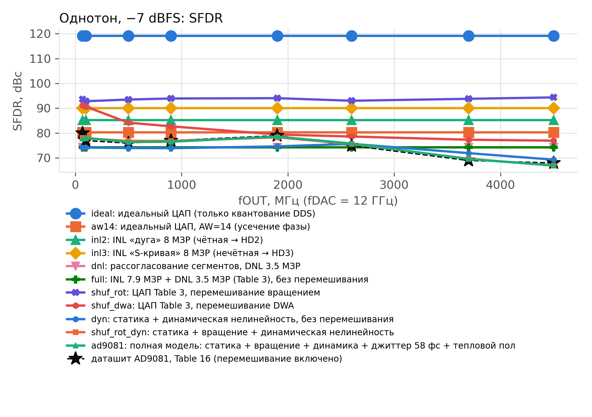
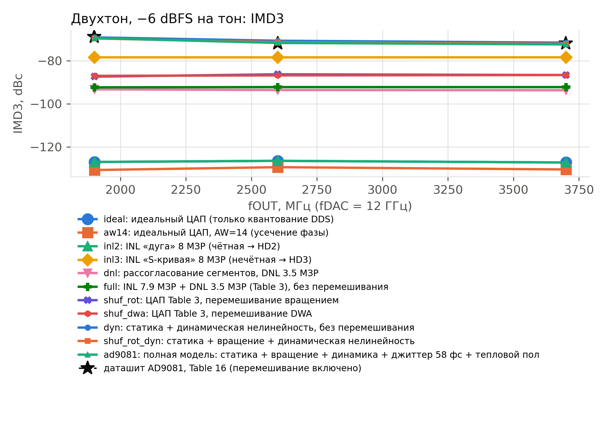

# DAC nonlinearity: measured (GNU Radio chain) vs AD9081 Table 16

Chain check: max |measured - model_ref| = 0.000 dB over 66 points (OK)

## Single tone, -7 dBFS

| scenario | fOUT, MHz | SFDR, dBc | worst spur | HD2, dBc | HD3, dBc | Table 16 SFDR |
|---|---|---|---|---|---|---|
| ideal | 70 | 119.1 |  | < -150 | -137.6 | 80 |
| ideal | 100 | 119.1 |  | < -150 | -137.6 | 77 |
| ideal | 500 | 119.1 |  | < -150 | -137.6 | 76 |
| ideal | 900 | 119.1 |  | < -150 | -137.6 | 77 |
| ideal | 1900 | 119.1 |  | < -150 | -137.6 | 79 |
| ideal | 2600 | 119.1 |  | < -150 | -137.6 | 75 |
| ideal | 3700 | 119.1 |  | < -150 | -137.6 | 69 |
| ideal | 4500 | 119.1 |  | < -150 | -137.6 | 68 |
| aw14 | 70 | 80.4 |  | < -150 | -129.4 | 80 |
| aw14 | 100 | 80.4 |  | < -150 | -129.4 | 77 |
| aw14 | 500 | 80.4 |  | < -150 | -129.4 | 76 |
| aw14 | 900 | 80.4 |  | < -150 | -129.4 | 77 |
| aw14 | 1900 | 80.4 |  | < -150 | -129.4 | 79 |
| aw14 | 2600 | 80.4 |  | < -150 | -129.4 | 75 |
| aw14 | 3700 | 80.4 |  | < -150 | -129.4 | 69 |
| aw14 | 4500 | 80.4 |  | < -150 | -129.4 | 68 |
| inl2 | 70 | 85.3 | HD2 | -85.3 | -137.6 | 80 |
| inl2 | 100 | 85.3 | HD2 | -85.3 | -137.6 | 77 |
| inl2 | 500 | 85.3 | HD2 | -85.3 | -137.6 | 76 |
| inl2 | 900 | 85.3 | HD2 | -85.3 | -137.6 | 77 |
| inl2 | 1900 | 85.3 | HD2 | -85.3 | -137.6 | 79 |
| inl2 | 2600 | 85.3 | HD2 | -85.3 | -137.6 | 75 |
| inl2 | 3700 | 85.3 | HD2 | -85.3 | -137.6 | 69 |
| inl2 | 4500 | 85.3 | HD2 | -85.3 | -137.6 | 68 |
| inl3 | 70 | 90.0 | HD3 | < -150 | -90.0 | 80 |
| inl3 | 100 | 90.0 | HD3 | < -150 | -90.0 | 77 |
| inl3 | 500 | 90.0 | HD3 | < -150 | -90.0 | 76 |
| inl3 | 900 | 90.0 | HD3 | < -150 | -90.0 | 77 |
| inl3 | 1900 | 90.0 | HD3 | < -150 | -90.0 | 79 |
| inl3 | 2600 | 90.0 | HD3 | < -150 | -90.0 | 75 |
| inl3 | 3700 | 90.0 | HD3 | < -150 | -90.0 | 69 |
| inl3 | 4500 | 90.0 | HD3 | < -150 | -90.0 | 68 |
| dnl | 70 | 74.3 | HD4 | -77.2 | -99.0 | 80 |
| dnl | 100 | 74.3 | HD4 | -77.2 | -99.0 | 77 |
| dnl | 500 | 74.3 | HD4 | -77.2 | -99.0 | 76 |
| dnl | 900 | 74.3 | HD4 | -77.2 | -99.0 | 77 |
| dnl | 1900 | 74.3 | HD4 | -77.2 | -99.0 | 79 |
| dnl | 2600 | 74.3 | HD4 | -77.2 | -99.0 | 75 |
| dnl | 3700 | 74.3 | HD4 | -77.2 | -99.0 | 69 |
| dnl | 4500 | 74.3 | HD4 | -77.2 | -99.0 | 68 |
| full | 70 | 74.3 | HD4 | -78.6 | -125.5 | 80 |
| full | 100 | 74.3 | HD4 | -78.6 | -125.5 | 77 |
| full | 500 | 74.3 | HD4 | -78.6 | -125.5 | 76 |
| full | 900 | 74.3 | HD4 | -78.6 | -125.5 | 77 |
| full | 1900 | 74.3 | HD4 | -78.6 | -125.5 | 79 |
| full | 2600 | 74.3 | HD4 | -78.6 | -125.5 | 75 |
| full | 3700 | 74.3 | HD4 | -78.6 | -125.5 | 69 |
| full | 4500 | 74.3 | HD4 | -78.6 | -125.5 | 68 |

## Two tones, -6 dBFS per tone

| scenario | fc, MHz | IMD3 2f1-f2 | IMD3 2f2-f1 | IMD3 worst, dBc | Table 16 IMD3 |
|---|---|---|---|---|---|
| ideal | 1901 | -133.4 | -126.9 | -126.9 | -69 |
| ideal | 2600 | -126.4 | < -150 | -126.4 | -72 |
| ideal | 3700 | -141.3 | -127.2 | -127.2 | -72 |
| aw14 | 1901 | -145.7 | -130.6 | -130.6 | -69 |
| aw14 | 2600 | -129.3 | -139.0 | -129.3 | -72 |
| aw14 | 3700 | -134.6 | -130.4 | -130.4 | -72 |
| inl2 | 1901 | -133.4 | -126.9 | -126.9 | -69 |
| inl2 | 2600 | -126.4 | < -150 | -126.4 | -72 |
| inl2 | 3700 | -141.3 | -127.2 | -127.2 | -72 |
| inl3 | 1901 | -78.5 | -78.5 | -78.5 | -69 |
| inl3 | 2600 | -78.5 | -78.5 | -78.5 | -72 |
| inl3 | 3700 | -78.5 | -78.4 | -78.4 | -72 |
| dnl | 1901 | -93.7 | -93.3 | -93.3 | -69 |
| dnl | 2600 | -93.9 | -93.6 | -93.6 | -72 |
| dnl | 3700 | -93.7 | -93.9 | -93.7 | -72 |
| full | 1901 | -92.3 | -92.8 | -92.3 | -69 |
| full | 2600 | -92.2 | -92.5 | -92.2 | -72 |
| full | 3700 | -92.4 | -92.2 | -92.2 | -72 |

